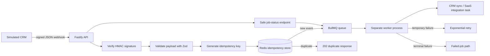

# Reliable Webhook Worker

Production-style webhook and background-job infrastructure for SaaS products and CRM integrations.

This repository demonstrates how Jawad Zeineddine builds reliable event ingestion: signed webhook intake, strict payload validation, idempotent duplicate handling, BullMQ queueing, retryable workers, terminal failure handling, and a safe job-status endpoint.

No client code, customer data, credentials, or production records are included.

## What It Demonstrates

- Fastify webhook receiver in strict TypeScript
- HMAC SHA-256 signature verification
- Zod payload validation
- deterministic idempotency keys
- Redis-backed duplicate rejection
- BullMQ enqueueing and separate worker processing
- exponential retry backoff for temporary failures
- unrecoverable failure path for terminal failures
- structured Pino logs with sensitive headers redacted
- safe `/jobs/:jobId` status endpoint
- unit and integration tests with Vitest
- Docker Compose Redis for local development
- GitHub Actions CI

## Architecture



## Quick Start

```bash
npm install
cp .env.example .env
docker compose up -d redis
npm run dev
```

In another terminal:

```bash
npm run worker
```

## Send A Demo Webhook

Create a demo payload:

```bash
PAYLOAD='{"eventId":"evt_01HZXKQ5FH8A3V1Q2W9R8T7Y6X","eventType":"contact.updated","occurredAt":"2026-07-28T10:30:00.000Z","accountId":"acct_demo","data":{"crmObjectId":"contact_123","email":"demo@example.com","name":"Demo Contact","status":"active"}}'
SECRET='replace-with-a-long-random-demo-secret'
SIGNATURE=$(PAYLOAD="$PAYLOAD" SECRET="$SECRET" node -e "const crypto=require('crypto'); console.log('sha256=' + crypto.createHmac('sha256', process.env.SECRET).update(process.env.PAYLOAD).digest('hex'))")
curl -i http://localhost:3000/webhooks/crm \
  -H "content-type: application/json" \
  -H "x-crm-signature: $SIGNATURE" \
  --data "$PAYLOAD"
```

Expected response:

```json
{
  "accepted": true,
  "duplicate": false,
  "idempotencyKey": "derived-sha256-key",
  "jobId": "same-as-idempotency-key"
}
```

Send the same request again and the API returns `202` with `duplicate: true` without enqueueing another job.

## Check Job Status

```bash
curl http://localhost:3000/jobs/<jobId>
```

The status endpoint returns only operational metadata: job id, name, BullMQ state, attempt count, timestamps, and failed reason when the job has failed. It does not return secrets or raw headers.

## Simulated Failure Modes

Set `data.status` to `temporary_failure` to simulate a retryable downstream failure.

Set `data.status` to `terminal_failure` to simulate a permanent failure that should move directly to the failed-job path.

## Quality Gates

```bash
npm run lint
npm test
npm run build
npm audit --omit=dev
docker compose config
```

Integration tests expect Redis at `REDIS_URL`, defaulting to `redis://localhost:6379`.

## Engineering Tradeoffs

- **Fastify over Next.js route handlers:** this sample is infrastructure-focused, so a small HTTP service is easier to run as an API container and background worker pair.
- **Redis idempotency reservation before queueing:** duplicates are rejected before they can produce duplicate jobs. In a production system, this is often paired with payload retention or an audit table.
- **BullMQ job id equals idempotency key:** this provides a second layer of duplicate protection at the queue level.
- **Exponential retries only for temporary failures:** terminal failures use BullMQ's unrecoverable error path so invalid data does not waste retry capacity.
- **Safe status endpoint:** status is useful for operations, but raw webhook bodies and signed headers are intentionally not exposed.
- **Demo failure switches:** `temporary_failure` and `terminal_failure` are explicit test hooks, not production business rules.

## Repository Scope

This is a public engineering sample. It is designed to show implementation quality without referencing private clients, usage metrics, production traffic, or confidential integration details.

## Contact

Jawad Zeineddine  
Full-Stack Engineer | White-Label Engineering Partner  
zjawad1999@gmail.com  
https://github.com/MJszeineddine
